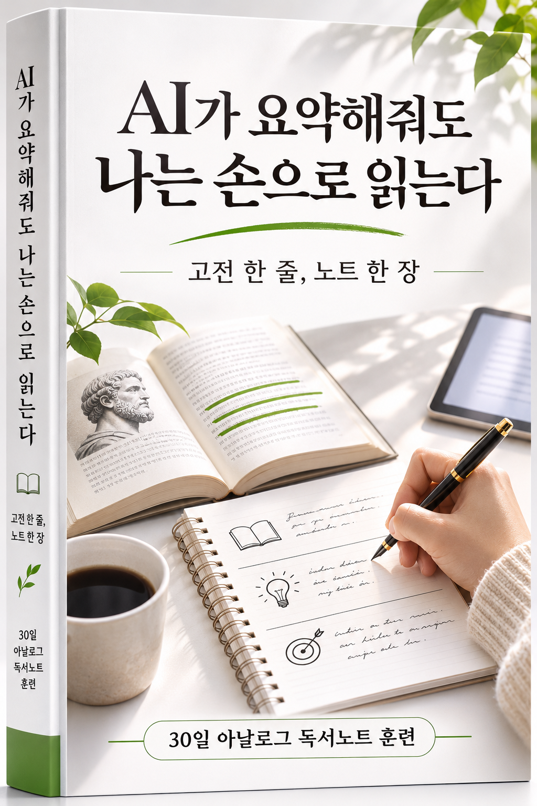

# AI가 요약해줘도 나는 손으로 읽는다

  

고전 한 줄, 노트 한 장 — 30일 아날로그 독서노트 훈련

*인사이트: 0부에서 전제를 세우고, 6부에서 다시 세상으로 나온다.*

AI에게 책을 요약해 달라고 하면 몇 초 안에 답이 나온다. 그 답을 읽고 나면 그 책을 안다고 느껴진다. 이 책은 그 느낌과 실제로 아는 것 사이의 거리를 다룬다. 요약은 AI에게 맡기되, 책에서 무엇을 발췌하고 무엇을 느꼈고 무엇을 질문으로 남길지는 손으로 쓴다. 그 과정을 30일짜리 훈련으로 만들었다.

이 책은 교양서가 아니라 따라 하는 실행 매뉴얼이다. 각 장 끝에 그날 해볼 일이나 체크리스트가 있다.

## 뷰어로 읽기

**https://leaf-kit.github.io/book-read-by-hand/**

차례, 검색, 다크모드, 체크리스트 저장을 지원하는 웹 뷰어다. 마크다운 파일을 직접 읽어도 되지만, 뷰어로 보면 더 편하다.

## 차례

### 0부 — 들어가며
- [0.1 왜 지금 손으로 읽고 쓰는가](<./part0/01-why-read-by-hand.md>)
- [0.2 AI 요약이 대신해주는 것, 대신해주지 못하는 것](<./part0/02-what-ai-summary-cannot.md>)
- [0.3 이 책을 읽고 쓰는 법: 준비물과 3단 노트](<./part0/03-how-to-use-this-book.md>)

### 1부 — 읽기: 한 권을 소화한다
- [1.1 요약의 착시: 읽었다는 느낌과 이해한 것의 차이](<./part1/01-illusion-of-summary.md>)
- [1.2 무엇을 읽을까: 고전과 입문서를 고르는 기준](<./part1/02-choosing-what-to-read.md>)
- [1.3 밑줄 규칙: 한 페이지에 세 줄만](<./part1/03-three-lines-rule.md>)
- [1.4 느리게 읽기: 멈추는 지점을 정하는 법](<./part1/04-slow-reading.md>)
- [1.5 다 읽지 못한 책을 대하는 법](<./part1/05-unfinished-books.md>)

### 2부 — 쓰기: 3단 노트 시스템
- [2.1 발췌: 베끼는 것과 고르는 것](<./part2/01-excerpt.md>)
- [2.2 내 생각: 한 문장이라도 내 말로 쓴다](<./part2/02-my-thought.md>)
- [2.3 질문: 책을 덮은 뒤에 남기는 질문](<./part2/03-question.md>)
- [2.4 노트 도구 고르기: 종이와 펜, 태블릿의 장단점](<./part2/04-choosing-tools.md>)
- [2.5 노트가 쌓일 때 정리하는 법](<./part2/05-organizing-notes.md>)

### 3부 — 연결하기: 내 관점 만들기
- [3.1 노트끼리 잇는 법](<./part3/01-linking-notes.md>)
- [3.2 한 권에서 한 주제로](<./part3/02-one-book-to-one-theme.md>)
- [3.3 내 문장으로 글 한 편 쓰기](<./part3/03-writing-my-sentences.md>)
- [3.4 대화로 가져가기: 독서모임과 토론](<./part3/04-discussion.md>)

### 4부 — AI와의 선 긋기
- [4.1 AI에게 맡겨도 되는 일과 안 되는 일](<./part4/01-what-to-delegate.md>)
- [4.2 AI를 읽기의 보조로 쓰는 법: 질문 생성, 반론 요청, 용어 설명](<./part4/02-ai-as-assistant.md>)
- [4.3 AI 문장과 내 문장을 구별하는 법](<./part4/03-distinguishing-sentences.md>)
- [4.4 요약은 AI가, 판단은 내가: 실전 워크플로우](<./part4/04-workflow.md>)

### 5부 — 30일 챌린지
- [5.1 챌린지 규칙과 준비](<./part5/01-challenge-rules.md>)
- [5.2 1주차 전반 (Day 1~4): 읽기의 속도를 늦춘다](<./part5/02-week1-early.md>)
- [5.3 1주차 후반 (Day 5~7): 읽기의 속도를 늦춘다](<./part5/03-week1-late.md>)
- [5.4 2주차 전반 (Day 8~11): 3단 노트를 몸에 익힌다](<./part5/04-week2-early.md>)
- [5.5 2주차 후반 (Day 12~14): 3단 노트를 몸에 익힌다](<./part5/05-week2-late.md>)
- [5.6 3주차 전반 (Day 15~18): 노트를 연결한다](<./part5/06-week3-early.md>)
- [5.7 3주차 후반 (Day 19~21): 노트를 연결한다](<./part5/07-week3-late.md>)
- [5.8 4주차 전반 (Day 22~26): 내 문장으로 마무리한다](<./part5/08-week4-early.md>)
- [5.9 4주차 후반 (Day 27~30): 내 문장으로 마무리한다](<./part5/09-week4-late.md>)
- [5.10 30일 이후: 습관으로 남기기](<./part5/10-after-30-days.md>)

### 6부 — 지속과 공유
- [6.1 슬럼프가 올 때](<./part6/01-slump.md>)
- [6.2 SNS에 노트를 공유하는 법: 인증과 기록 사이](<./part6/02-sharing-on-sns.md>)
- [6.3 함께 하는 챌린지 운영하기](<./part6/03-running-group-challenge.md>)
- [6.4 텍스트힙을 넘어서: 인증용이 아닌 진짜 독서](<./part6/04-beyond-text-hip.md>)

### 부록
- [A. 인쇄용 3단 노트 템플릿](<./appendix/a-print-template.md>)
- [B. 30일 챌린지 체크리스트 전체](<./appendix/b-30day-checklist.md>)
- [C. 용어집](<./appendix/c-glossary.md>)
- [D. 함께 읽기 좋은 고전, 입문서 목록](<./appendix/d-reading-list.md>)

## 읽는 경로

한 번에 처음부터 끝까지 읽지 않아도 된다. 지금 상황에 맞는 경로를 고른다.

| 상황 | 추천 경로 |
|---|---|
| 책을 읽어도 남는 게 없다고 느낀다 | 0부 → 1부 |
| 노트는 쓰는데 무엇을 써야 할지 모른다 | 2부 |
| 노트가 쌓이기만 하고 연결이 안 된다 | 3부 |
| AI 요약 도구를 어디까지 믿어야 할지 궁금하다 | 4부 |
| 당장 오늘부터 실행하고 싶다 | 5부 1장부터 바로 시작 |
| 혼자 하다가 지쳤다 | 6부 |

## 구성

| 부 | 다루는 것 |
|---|---|
| 0부 | 이 책의 전제와 3단 노트(발췌, 내 생각, 질문)의 정의 |
| 1부 | 책을 소화하는 읽기 방법 |
| 2부 | 3단 노트를 쓰는 구체적인 방법 |
| 3부 | 쌓인 노트를 연결해 내 관점으로 만드는 법 |
| 4부 | AI에게 맡길 일과 내가 할 일의 경계 |
| 5부 | 30일 동안 따라 하는 실행 챌린지 |
| 6부 | 혼자 또는 함께, 챌린지 이후까지 지속하는 법 |
| 부록 | 인쇄용 템플릿, 전체 체크리스트, 용어집, 읽을 책 목록 |

## 이 책이 하지 않은 것

- 특정 노트 앱이나 필기구 브랜드를 추천하지 않는다. 종이 노트, 펜, 태블릿처럼 종류로만 다룬다.
- AI를 쓰지 말라고 하지 않는다. 어디까지 맡기고 어디부터 직접 할지 선을 그을 뿐이다.
- 출처 없는 통계나 설문으로 독자를 설득하지 않는다. 사례가 필요한 자리는 가상의 예시라고 표시했다.
- 특정 번역서나 판본을 추천하지 않는다. 부록 D의 고전 목록도 저자와 책 이름만 다룬다.

## 라이선스와 기여

이 책은 무료로 공개한다. 오탈자나 끊어진 링크를 발견하면 이슈나 풀 리퀘스트로 알려주면 좋다.
